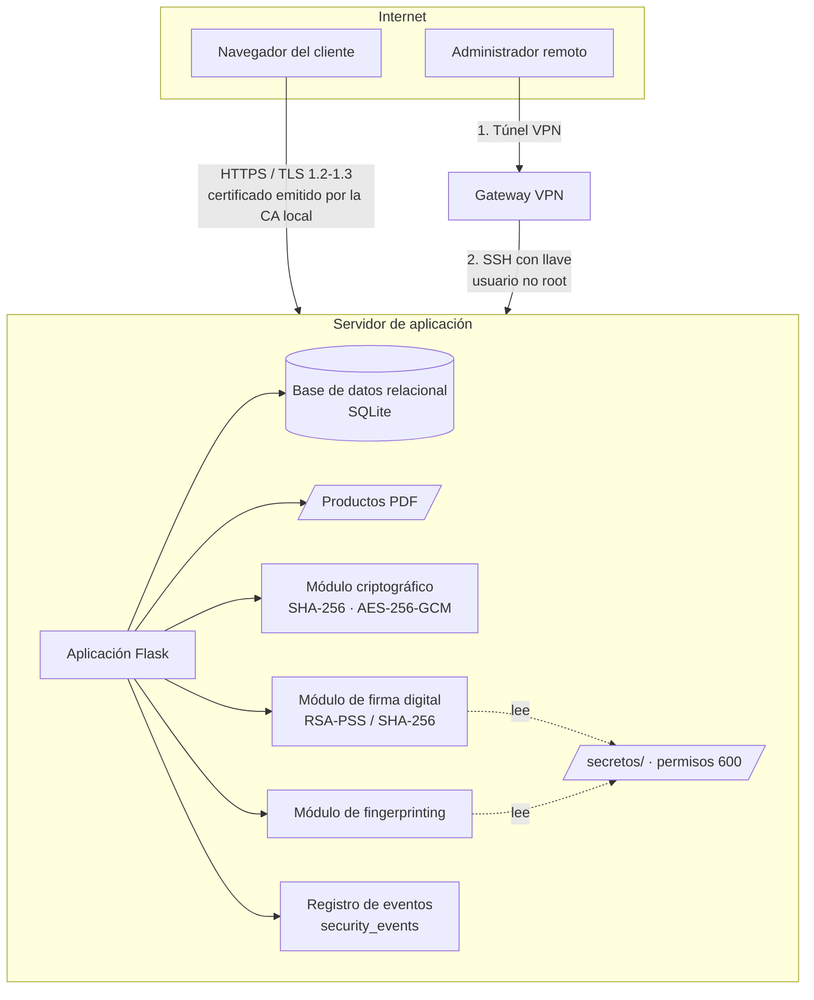
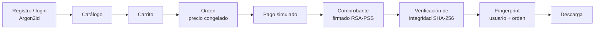
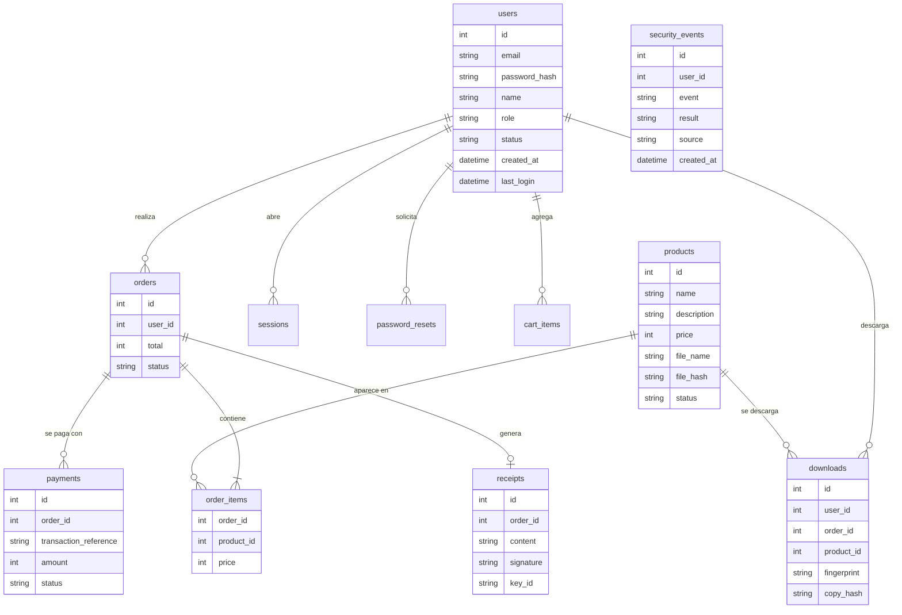

# Arquitectura de seguridad

## 1. Vista general



### Flujo principal



## 2. Servicios de seguridad y mecanismos

| Servicio | Mecanismo en el sistema | Dónde está |
|---|---|---|
| **Confidencialidad** | HTTPS con TLS 1.2 como mínimo (normalmente 1.3) y solo suites ECDHE con AES-GCM o ChaCha20 (secreto perfecto hacia adelante) | `aplicacion/__main__.py` |
| | Contraseñas derivadas con Argon2id: nadie, ni el ADMINISTRADOR, puede obtener la original | `seguridad.py` |
| | Respaldos cifrados con AES-256-GCM, con la clave guardada aparte | `scripts/respaldo.py` |
| | Tokens de sesión y de recuperación guardados como SHA-256 | `seguridad.py`, `rutas/publico.py` |
| | Cookies `Secure`, `HttpOnly` y `SameSite=Strict`; HSTS | `config.py`, `__init__.py` |
| | Claves privadas fuera del código y del repositorio (`secretos/`, permisos 600) | `.gitignore`, `criptografia.py` |
| | Acceso administrativo solo por VPN y luego SSH | `docs/despliegue_ssh_vpn_ipsec.md` |
| **Integridad** | SHA-256 de cada producto al registrarlo, verificado **antes de cada descarga** | `servicios.py` |
| | Firma RSA-PSS de comprobantes: cualquier cambio invalida la firma | `servicios.py`, `criptografia.py` |
| | Etiqueta AES-GCM en los respaldos: un respaldo alterado no se descifra | `criptografia.py` |
| | HMAC-SHA256 en el fingerprint: no se puede falsificar ni cambiar el usuario | `fingerprint.py` |
| | Bitácora de solo inserción: triggers de la BD bloquean `UPDATE` y `DELETE` | `schema.sql` |
| | Token CSRF en todo `POST`; precio copiado a `order_items` | `seguridad.py`, `rutas/cliente.py` |
| **Disponibilidad** | Respaldo cifrado de la BD y los productos, con restauración verificada | `scripts/respaldo.py`, `scripts/restaurar.py` |
| | Bloqueo **temporal** por fuerza bruta (no permanente) | `rutas/publico.py` |
| | Límite de 20 MB por petición; errores controlados sin caída del servicio | `config.py`, `__init__.py` |
| **Autenticación** | Usuarios: Argon2id con verificación de la biblioteca, sesiones del lado del servidor y expiración por inactividad y absoluta | `seguridad.py` |
| | Servidor: certificado X.509 emitido por la CA local, validado por el cliente | `scripts/crear_ca.py` |
| | Administradores: llave SSH, sin contraseña ni root | `docs/config/sshd_config` |
| **No repudio** | Comprobante firmado con la clave privada que solo posee la plataforma; cualquiera lo verifica con la clave pública | `servicios.py`, `scripts/verificar_comprobante.py` |
| | Fingerprint que liga cada copia a usuario, orden y producto, autenticado con HMAC | `fingerprint.py` |
| | Bitácora inmutable con usuario, evento, fecha, resultado y origen | `security_events` |

> La firma digital da no repudio **del emisor** (la plataforma). Lo que hizo el cliente se sustenta con la bitácora y el fingerprint, que son evidencia, pero no firma del cliente. Esta limitación se analiza en la auditoría.

## 3. Criptografía aplicada

| Uso | Algoritmo | Parámetros | Biblioteca |
|---|---|---|---|
| Contraseñas | Argon2id | 64 MiB, 3 iteraciones, 4 hilos, sal aleatoria de 16 bytes | `argon2-cffi` |
| Integridad de archivos | SHA-256 | — | `hashlib` |
| Firma de comprobantes | RSA-PSS + SHA-256 | RSA 3072 bits, MGF1-SHA256, sal máxima | `cryptography` |
| Cifrado de respaldos | AES-256-GCM | Nonce aleatorio de 96 bits, etiqueta de 128 bits, AAD `PSCBK1` | `cryptography` |
| Autenticidad del fingerprint | HMAC-SHA256 | Clave de 256 bits, truncado a 64 bits | `hmac` |
| Tokens (sesión, CSRF, recuperación) | CSPRNG | 256 bits (`secrets.token_urlsafe(32)`) | `secrets` |
| PKI | X.509 v3 | CA RSA 4096 (10 años) y servidor RSA 2048 (397 días, SAN) | `cryptography` |
| TLS | TLS 1.2 y 1.3 | ECDHE + AES-GCM / ChaCha20 | `ssl` (OpenSSL) |

### Formato del comprobante firmado

```json
{
  "contenido": {
    "emisor": "Plataforma Segura de Contenido Digital",
    "numero_orden": 1,
    "usuario": {"id": 3, "email": "cliente1@demo.local", "nombre": "Carla Cliente"},
    "productos": [{"id": 1, "nombre": "Manual de Python Básico", "precio_centavos": 14900}],
    "total_centavos": 14900,
    "moneda": "MXN",
    "fecha": "2026-11-18T03:57:14Z",
    "referencia_transaccion": "SIM-3D1E2B0747260C39"
  },
  "firma": "<firma RSA-PSS en Base64>",
  "algoritmo": "RSA-PSS-SHA256",
  "key_id": "b96432894e7a8cf2669b37c3d2b5163a"
}
```

`contenido` se serializa en **JSON canónico** (claves ordenadas y sin espacios) antes de calcular el hash y firmar. Así el firmante y el verificador procesan exactamente los mismos bytes.

## 4. Gestión de claves

| Clave | Ubicación | En el repositorio | Rotación |
|---|---|---|---|
| CA local (privada) | `secretos/ca.key` | No | 10 años. En producción se guardaría fuera de línea |
| Servidor TLS (privada) | `secretos/servidor.key` | No | Cada 397 días, con `crear_ca.py --forzar` |
| Firma de comprobantes (privada) | `secretos/firma_privada.pem` | No | Al rotarla, la clave pública anterior se conserva para verificar comprobantes viejos |
| Firma (pública) | `claves_publicas/firma_publica.pem` | **Sí** | — |
| Fingerprint (HMAC) | `secretos/fingerprint.key` | No | No se rota: invalidaría los fingerprints emitidos |
| Respaldo (AES) | `secretos/respaldo.key` | No | Se custodia aparte de los respaldos |
| Secreto de la app | `secretos/app_secret.key` | No | Rotarla solo invalida los formularios abiertos |

## 5. Control de acceso

- **Privilegio mínimo:** cada ruta declara los roles permitidos con `@roles_requeridos(...)`. Cualquier otro rol recibe `403` y se registra `ACCESS_DENIED`.
- **Control a nivel de objeto:** órdenes, comprobantes y descargas se consultan siempre con `user_id = usuario autenticado`. No basta con conocer el número de orden.
- **Separación de responsabilidades:** el OPERADOR administra el catálogo y las órdenes, pero no usuarios ni roles. El ADMINISTRADOR administra usuarios y roles, pero no el catálogo. Nadie puede cambiar su propio rol ni desactivar su propia cuenta.
- **Registro público:** siempre crea cuentas CLIENTE. Aunque se envíe un campo `role` manipulado, se ignora.
- **Cambio de rol, desactivación o cambio de contraseña:** revoca todas las sesiones del usuario afectado.

## 6. Principios de aplicación segura

| Principio | Implementación |
|---|---|
| Validación de entradas | Listas blancas con regex para correo y precio, longitudes máximas y conversores `<int:>` en las rutas. Los PDF se validan por firma `%PDF-` y por estructura |
| Inyección SQL | 100 % consultas parametrizadas |
| XSS | Autoescape de Jinja2 y CSP `default-src 'self'` sin scripts en línea |
| CSRF | Token por sesión (o cookie firmada con HMAC para anónimos) en todo `POST`, más `SameSite=Strict` |
| Sesiones | Token aleatorio de 256 bits, guardado en la BD solo como hash. Expira tras 30 min de inactividad o 8 h en total, se rota en cada login y es revocable |
| Enumeración de usuarios | El login, el registro y la recuperación responden con el mismo mensaje. Si el usuario no existe se ejecuta un hash ficticio para igualar el tiempo de respuesta |
| Fuerza bruta | Bloqueo temporal tras 5 intentos durante 15 min; el ADMINISTRADOR puede configurarlo |
| Política de contraseñas | Longitud mínima configurable (10 por defecto), al menos una mayúscula, una minúscula y un número. El navegador muestra los requisitos en vivo y bloquea el envío si falta alguno; el servidor vuelve a validar las mismas reglas en `validar_password`, así que saltarse el JavaScript no sirve |
| Información interna | La interfaz no revela detalles del servidor: por ejemplo, la recuperación de contraseña solo indica que llegará un correo, y el detalle del producto no expone el SHA-256 (solo lo ve el OPERADOR) |
| Manejo de errores | Páginas genéricas para 400, 403, 404, 413 y 500. El detalle técnico va a `base_de_datos/errores.log` y `DEBUG` está desactivado |
| Redirecciones | `next` solo acepta rutas internas relativas |
| Enlaces por correo | Se construyen con `PUBLIC_BASE_URL` fija, no con la cabecera `Host` |
| Archivos subidos | Se guardan con un nombre aleatorio interno; el nombre del usuario nunca toca el disco |
| Cabeceras | HSTS, CSP, `X-Frame-Options: DENY`, `nosniff`, `Referrer-Policy: no-referrer` y `Cache-Control: no-store` |

## 7. Fingerprinting

### Identificador

```
SCD1-<fid>-U<usuario>-O<orden>-P<producto>-<etiqueta>
ej.: SCD1-ebf9546a-U3-O1-P1-ce2e46d8fa7fc642
```

- `fid`: 32 bits aleatorios por descarga. Distingue descargas repetidas del mismo producto.
- `etiqueta`: HMAC-SHA256(clave, `fid|usuario|orden|producto`), truncado a 64 bits. Sin la clave no se puede fabricar un identificador válido ni cambiar el usuario para culpar a otra persona; esto lo comprueba la prueba `test_fingerprint_falsificado_es_rechazado`.

### Técnica: capas redundantes dentro del contenido del PDF

1. **Texto invisible en cada página.** El identificador se escribe dos veces por página, en los márgenes superior e inferior, con el **modo de renderizado de texto 3** de PDF ("ni relleno ni contorno"). El visor no lo dibuja, pero forma parte del flujo de contenido de la página.
2. **Metadato del documento.** Clave `/Fingerprint` en el diccionario `Info`.

### Justificación

| Criterio | Resultado | Evidencia |
|---|---|---|
| **Imperceptibilidad** | El render de la copia es idéntico píxel a píxel al original | `evidencias/imperceptibilidad_fingerprint.txt`, `test_fingerprint_imperceptible` |
| **Robustez** | Resiste renombrar el archivo, eliminar los metadatos, extraer páginas sueltas y reguardar el PDF | `test_fingerprint_sobrevive_sin_metadatos`, `test_fingerprint_sobrevive_extraer_una_pagina` |
| **Capacidad** | Unos 40 caracteres por inserción (crece con el número de dígitos de los ids), con 2 inserciones por página más el metadato. Alcanza para identificar usuario, orden, producto y descarga | — |
| **Limitación** | No resiste imprimir y escanear, rasterizar a imagen ni quitar el texto invisible con herramientas especializadas | Hallazgo H3 de la auditoría |

### Detección

Una copia sospechosa se analiza en **Administrador → Fingerprint** o con `python scripts/detectar_fingerprint.py copia.pdf`. Se extrae el identificador, se valida el HMAC y se busca en `downloads`, lo que devuelve usuario, orden, producto, fecha e IP de la descarga.

## 8. Registro de eventos

Cada evento guarda: `user_id`, `email`, `event`, `result` (EXITO, FALLO o DENEGADO), `source` (IP), `details` y `created_at` en UTC.

| Requeridos | Adicionales |
|---|---|
| LOGIN_SUCCESS, LOGIN_FAILED, LOGOUT, PASSWORD_RESET, ORDER_CREATED, PAYMENT_APPROVED, DOWNLOAD, ROLE_CHANGED, ACCOUNT_DISABLED, SIGNATURE_CREATED, FINGERPRINT_CREATED | ACCESS_DENIED, ACCOUNT_LOCKED, ACCOUNT_ENABLED, CSRF_REJECTED, PASSWORD_CHANGED, PASSWORD_RESET_REQUESTED, PAYMENT_DECLINED, PRODUCT_CREATED, PRODUCT_UPDATED, PRICE_CHANGED, PRODUCT_STATUS_CHANGED, ORDER_STATUS_CHANGED, SESSION_REVOKED, SECURITY_SETTINGS_CHANGED, SIGNATURE_VERIFIED, INTEGRITY_FAILED, FINGERPRINT_DETECTED, BACKUP_CREATED, BACKUP_RESTORED, USER_REGISTERED, PROFILE_UPDATED |

Nunca se registran contraseñas, tokens ni números de tarjeta.

## 9. Modelo de datos


