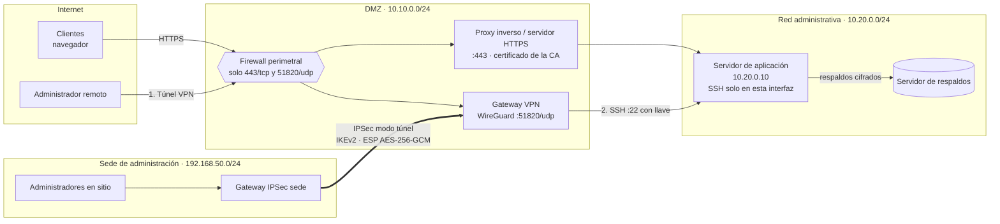

# Administración segura: SSH, VPN e IPSec

Este documento cubre las secciones 14 y 15 del proyecto. La aplicación de los clientes se expone por **HTTPS**. La administración del servidor **no** se expone a Internet: primero se entra a la red administrativa por **VPN** y después se abre la sesión **SSH**. **IPSec en modo túnel** protege el tráfico entre sedes a nivel de red.

> Según el alcance del proyecto, la VPN y el IPSec se **diseñan y justifican**; no se implementan desde cero. Los archivos de `docs/config/` son la configuración de referencia del diseño.

## 1. Arquitectura de despliegue



### Reglas de firewall

| Origen | Destino | Puerto | Acción | Motivo |
|---|---|---|---|---|
| Internet | Proxy HTTPS | 443/tcp | Permitir | Tráfico de clientes |
| Internet | Gateway VPN | 51820/udp | Permitir | Entrada al túnel administrativo |
| Gateway sede (IP fija) | Gateway VPN | 500 y 4500/udp, ESP | Permitir | Túnel IPSec sitio a sitio |
| Red VPN 10.99.0.0/24 | 10.20.0.10 | 22/tcp | Permitir | SSH solo desde la VPN |
| Internet | 10.20.0.0/24 | cualquiera | **Denegar** | La red administrativa nunca es visible desde Internet |
| Cualquiera | Cualquiera | cualquiera | **Denegar** | Política por defecto |

### Orden de acceso de un administrador

```
Internet
   ↓
VPN            (WireGuard: llave del dispositivo, solo IPs autorizadas)
   ↓
Red administrativa 10.20.0.0/24
   ↓
SSH            (usuario psc-admin, llave Ed25519, sin root y sin contraseña)
   ↓
Servidor de aplicación  →  sudo (solo cuando es necesario, queda registrado)
```

Un atacante necesita dos credenciales distintas, la llave de la VPN y la llave SSH, y además pasar el firewall, que solo admite el puerto 22 desde la red VPN.

## 2. Administración por SSH

### 2.1 Usuario administrativo distinto de root

```bash
# En el servidor (una sola vez, desde la consola del proveedor)
sudo adduser --disabled-password --gecos "" psc-admin
sudo usermod -aG sudo psc-admin
sudo mkdir -p /home/psc-admin/.ssh
sudo chmod 700 /home/psc-admin/.ssh
```

### 2.2 Autenticación por par de claves

```bash
# En la computadora del administrador
ssh-keygen -t ed25519 -a 100 -C "psc-admin@laptop" -f ~/.ssh/psc_admin_ed25519
# Copiar la clave PÚBLICA al servidor
ssh-copy-id -i ~/.ssh/psc_admin_ed25519.pub psc-admin@10.20.0.10
# En el servidor
sudo chmod 600 /home/psc-admin/.ssh/authorized_keys
```

`-a 100` aplica 100 rondas de KDF a la frase de paso que protege la clave privada en disco.

### 2.3 Endurecimiento del servicio

La configuración completa está en [`docs/config/sshd_config`](config/sshd_config):

| Control | Directiva | Riesgo que mitiga |
|---|---|---|
| Sin acceso de root | `PermitRootLogin no` | Compromiso directo de la cuenta con todos los privilegios |
| Solo llaves | `PasswordAuthentication no`, `AuthenticationMethods publickey` | Fuerza bruta y robo de contraseñas |
| Lista blanca de usuarios | `AllowUsers psc-admin` | Acceso con cuentas de servicio u olvidadas |
| Solo red administrativa | `ListenAddress 10.20.0.10` | Exposición de SSH a Internet |
| Pocos intentos | `MaxAuthTries 3`, `LoginGraceTime 30`, `MaxStartups` | Ataques automatizados y agotamiento de conexiones |
| Algoritmos modernos | `curve25519`, `chacha20-poly1305`, `aes-gcm`, `ed25519` | Algoritmos débiles o heredados |
| Sin reenvíos | `AllowTcpForwarding no`, `X11Forwarding no`, `AllowAgentForwarding no` | Pivoteo hacia otras redes |
| Sesiones inactivas | `ClientAliveInterval 300`, `ClientAliveCountMax 2` | Terminales abiertas sin vigilancia |
| Auditoría | `LogLevel VERBOSE` | Saber qué llave entró y cuándo |

Controles complementarios en el servidor:

```bash
sudo ufw default deny incoming
sudo ufw allow from 10.99.0.0/24 to 10.20.0.10 port 22 proto tcp
sudo ufw enable
sudo apt install fail2ban           # bloquea IPs con intentos repetidos
sudo chown -R pscapp:pscapp /opt/psc/secretos && sudo chmod 700 /opt/psc/secretos
```

La aplicación corre con un usuario de servicio sin privilegios (`pscapp`), distinto de `psc-admin`. Es el único que puede leer `secretos/`.

### 2.4 Verificación de la huella del servidor

En la primera conexión se compara la huella que muestra el cliente con la del servidor, obtenida por consola:

```bash
ssh-keygen -lf /etc/ssh/ssh_host_ed25519_key.pub
```

Así se evita un ataque de intermediario en la primera conexión (TOFU).

## 3. VPN

**Propuesta:** WireGuard en un gateway dedicado de la DMZ ([`docs/config/wireguard_servidor_vpn.conf.ejemplo`](config/wireguard_servidor_vpn.conf.ejemplo)).

| Decisión | Justificación |
|---|---|
| WireGuard | Código pequeño y auditable, criptografía fija y moderna (Curve25519, ChaCha20-Poly1305, BLAKE2s) y configuración sencilla |
| Una llave por dispositivo | Revocar a un administrador es borrar su `[Peer]` |
| `AllowedIPs` /32 por administrador | Cada dispositivo tiene una IP fija dentro del túnel; los registros identifican quién hizo qué |
| El gateway solo reenvía a 10.20.0.10:22 | La VPN no da acceso a toda la red, solo al servicio SSH |
| SSH sigue exigiendo su propia llave | Defensa en profundidad: robar la llave de la VPN no basta |

**Alternativa equivalente:** una VPN de acceso remoto IKEv2/IPSec con certificados emitidos por la CA del proyecto.

## 4. IPSec

IPSec protege el tráfico **a nivel de red (capa 3)**: cifra y autentica paquetes IP sin que las aplicaciones tengan que cambiar. Se compone de:

- **IKEv2:** negocia las claves y autentica a los extremos con certificados o PSK.
- **ESP (Encapsulating Security Payload):** confidencialidad, integridad y protección contra repetición.
- **AH:** solo da integridad. No se usa porque no cifra y es incompatible con NAT.

### Modo transporte vs. modo túnel

| | Modo transporte | **Modo túnel** |
|---|---|---|
| Qué se protege | Solo la carga útil; la cabecera IP original queda visible | **El paquete IP completo**, encapsulado en uno nuevo |
| Uso típico | Comunicación directa entre dos equipos | **Gateway a gateway** (sitio a sitio) y acceso remoto |
| Qué ve un observador | Las IPs reales de origen y destino | Solo las IPs de los gateways |

### Dónde se usaría IPSec en esta arquitectura

1. **Sitio a sitio entre la sede de administración y el centro de datos (modo túnel).** Los administradores en sitio entran a la red 10.20.0.0/24 por un túnel permanente entre los dos gateways. Ver [`docs/config/ipsec_sitio_a_sitio.conf.ejemplo`](config/ipsec_sitio_a_sitio.conf.ejemplo): IKEv2, autenticación con certificados de la CA y ESP AES-256-GCM con PFS (ECDH P-384).
2. **Replicación de respaldos hacia un sitio alterno (modo túnel).** El servidor de respaldos copia los archivos cifrados a otra sede. Aunque los respaldos ya van cifrados con AES-GCM, IPSec oculta también los metadatos del tráfico y autentica el destino.
3. **Acceso remoto IKEv2 (modo túnel)**, como alternativa a WireGuard para administradores con clientes IPSec nativos (Windows, macOS, iOS y Android lo traen integrado).

```
Sede (192.168.50.0/24)                                     Centro de datos (10.20.0.0/24)
 [PC admin] → [gw-sede] ═══ ESP( IP original + datos ) ═══ [gw-dc] → [servidor 10.20.0.10]
                 203.0.113.10        Internet              198.51.100.20
```

### Relación entre TLS, SSH, VPN e IPSec

| Tecnología | Capa | Qué protege en este proyecto |
|---|---|---|
| TLS (HTTPS) | Transporte / aplicación | Comunicación cliente ↔ aplicación web |
| SSH | Aplicación | Sesión administrativa sobre el servidor |
| VPN (WireGuard o IKEv2) | Red | Entrada a la red administrativa |
| IPSec modo túnel | Red | Tráfico entre gateways y sedes |
